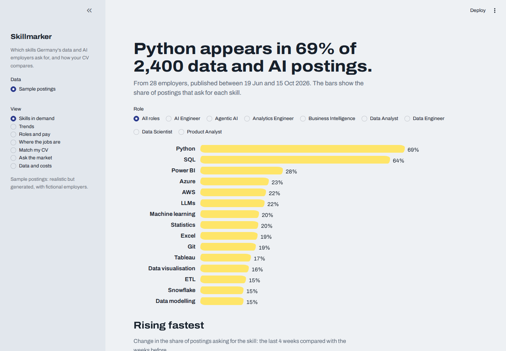
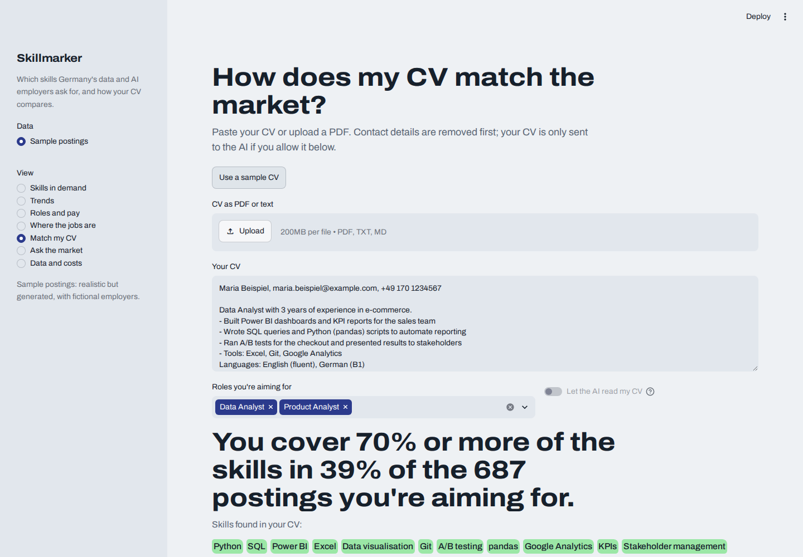
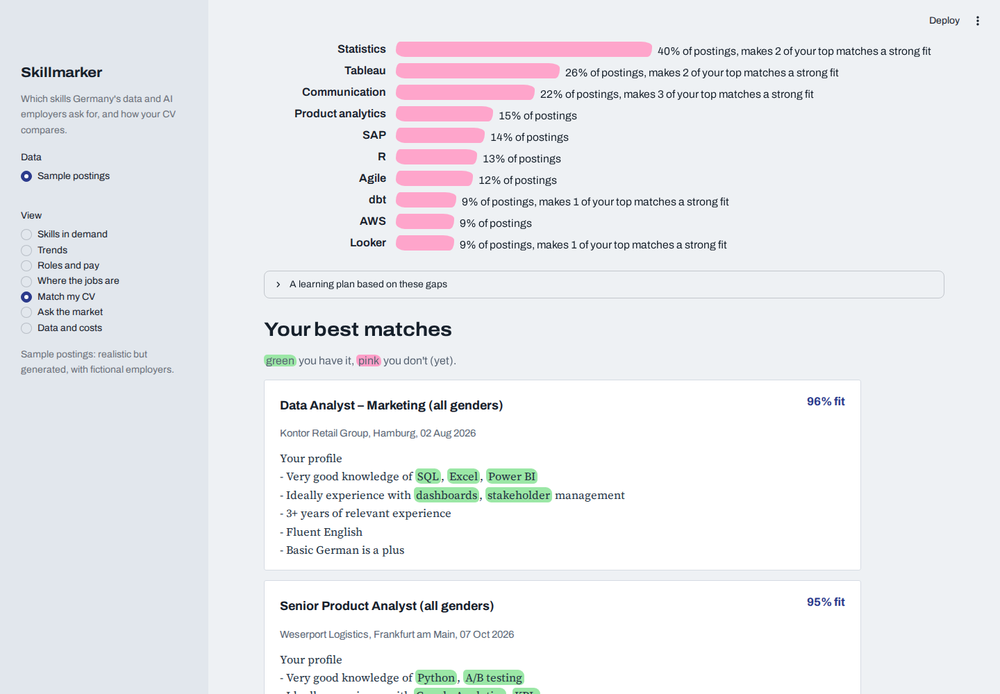
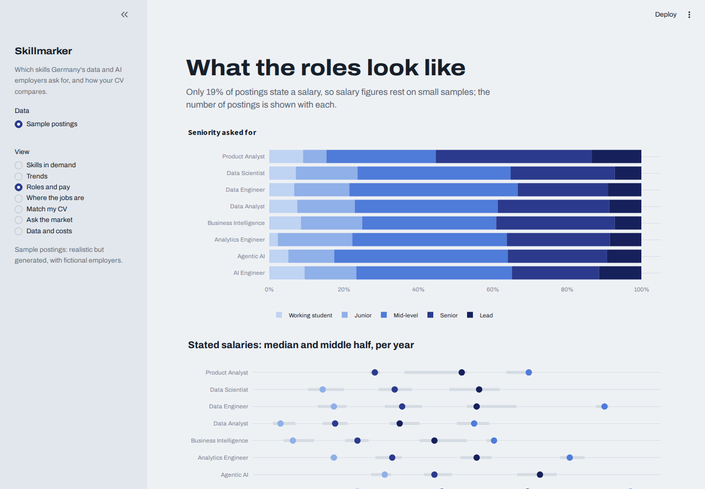
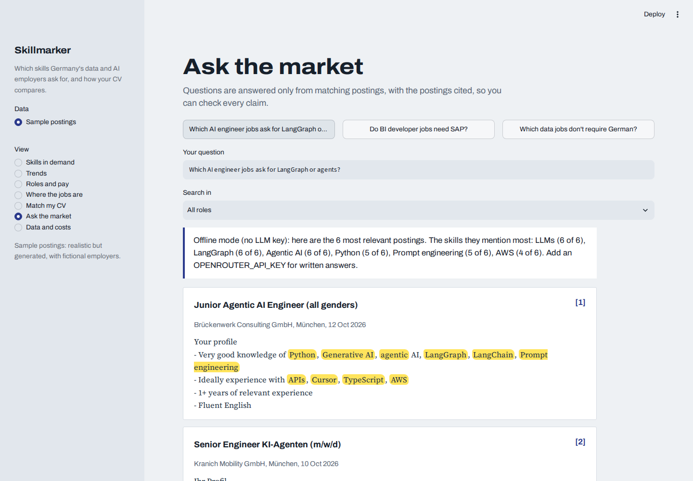
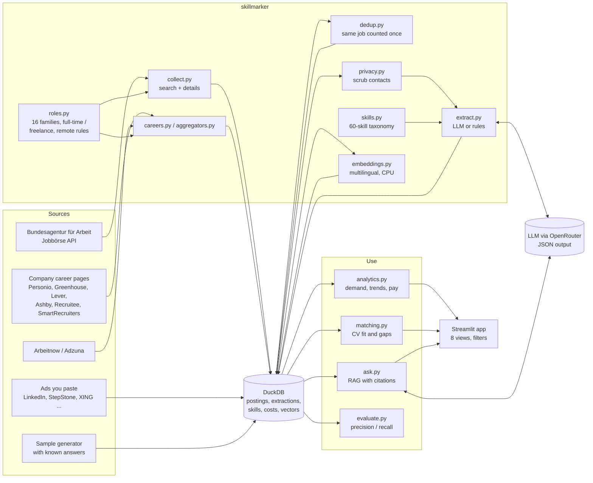
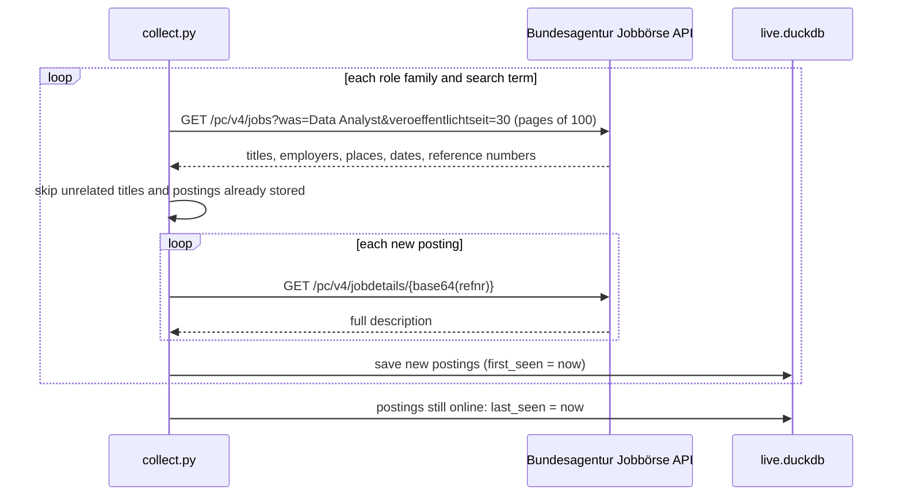
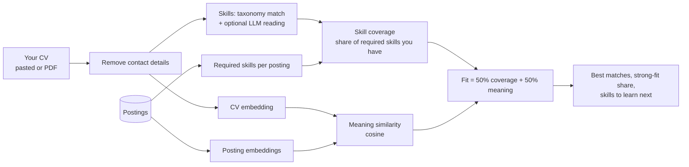
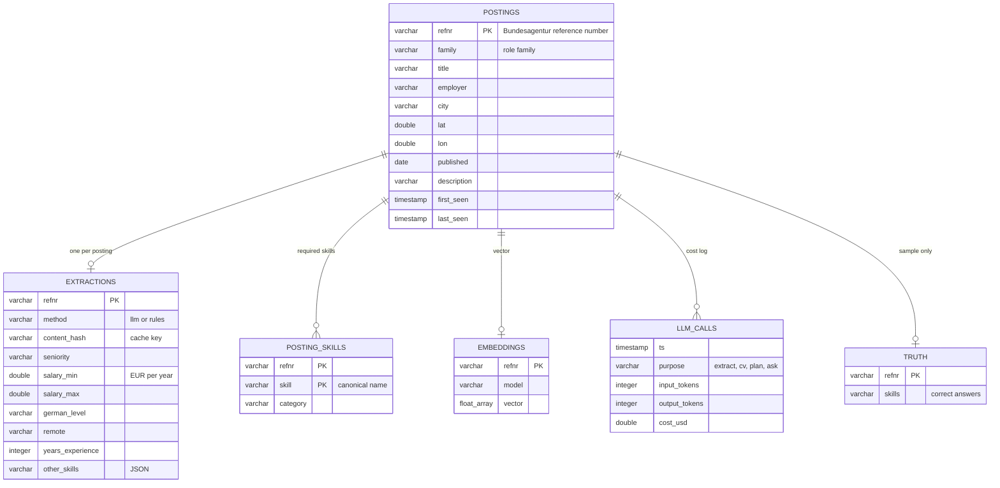

# Skillmarker: the German data and AI job market, highlighted

Which skills do German employers ask for in data and AI roles, how is that changing, and how does **my** CV compare? Skillmarker collects job postings from the **Bundesagentur für Arbeit**, **company career pages** and **job aggregators**, uses an **LLM** to extract skills, seniority, salary, language, employment type and remote policy from each posting, and turns them into a market analysis plus a personal CV matcher with links to apply.

**Scope:** 16 analytics and AI role families (below), **full-time and freelance roles only**, in Germany **or remote**. Part-time, working-student, internship and apprenticeship postings are left out.



## Contents

- [What it answers](#what-it-answers)
- [Sources](#sources)
- [Role families](#role-families)
- [Filters: employment and remote work](#filters-employment-and-remote-work)
- [AI techniques used](#ai-techniques-used)
- [Use it on your phone](#use-it-on-your-phone)
- [Quick start](#quick-start)
- [A tour of the app](#a-tour-of-the-app)
- [Architecture](#architecture)
- [Collecting real postings](#collecting-real-postings)
- [LLM extraction at scale: costs, caching, budget](#llm-extraction-at-scale-costs-caching-budget)
- [Measuring extraction quality](#measuring-extraction-quality)
- [Matching a CV](#matching-a-cv)
- [Ask the market (RAG)](#ask-the-market-rag)
- [Privacy](#privacy)
- [Data model](#data-model)
- [The sample data](#the-sample-data)
- [Tests and CI](#tests-and-ci)
- [Demo video](#demo-video)
- [Project structure](#project-structure)
- [Limitations](#limitations)
- [Ideas to extend it](#ideas-to-extend-it)
- [Talking about it in an interview](#talking-about-it-in-an-interview)
- [Credits and licences](#credits-and-licences)

## What it answers

1. **Which skills are in demand,** overall and per role?
2. **What is rising and falling,** week by week?
3. **What do the roles look like:** seniority, stated salaries, German-language requirements, remote work?
4. **Where are the jobs,** and which employers hire most?
5. **How does my CV match:** which postings fit, and which skills should I learn next?
6. **Ask anything** about the postings, with answers that cite the ads they come from.

## Sources

| Source | What it covers | Key needed? | Command |
|---|---|---|---|
| **Bundesagentur für Arbeit** | Germany's largest job board, including ads from partner job boards; regular jobs and the self-employment (freelance) category | No | `python -m skillmarker.collect` |
| **Company career pages** | All jobs of the companies in `companies.json`, through their recruiting system's public job feed: **Personio, Greenhouse, Lever, Ashby, Recruitee, SmartRecruiters** | No | `python -m skillmarker.careers` |
| **Arbeitnow** | A free public API of jobs in Germany, many from startups | No | `python -m skillmarker.aggregators` |
| **Adzuna** | A job search engine with an official API for Germany (descriptions are short snippets) | Free developer key | `python -m skillmarker.aggregators` |
| **Ads you paste** | Any ad you find on LinkedIn, StepStone, XING or a company website, via **Add a job ad** in the app | No | in the app |

**Not included, on purpose:** LinkedIn, StepStone, XING, Indeed and Wellfound. Their terms of use prohibit automated collection and they offer no public job-search API. Ads from them can be pasted into the app instead.

**De-duplication.** The same job often appears in several sources. Postings with the same employer (ignoring GmbH, AG and so on) and a near-identical title (ignoring "(m/w/d)") in the same city, or remote, are treated as one job. The copy with the longest description is kept, and the others are excluded from all statistics (`dedup.py`).

### Following company career pages

`companies.json` lists companies by name. Discovery finds which recruiting system each one uses, by trying the likely addresses on every supported system:

```bash
python -m skillmarker.careers --discover            # resolve all companies in companies.json (once)
python -m skillmarker.careers --add "Example GmbH"  # add one more company
python -m skillmarker.careers --list                # see which system each company uses
python -m skillmarker.careers                       # collect their jobs
```

The starter list has 60 German tech companies, startups and data consultancies. Companies whose system isn't supported (for example Workday or SAP SuccessFactors) are marked `"none"`; you can also set `"ats"` and `"slug"` by hand.

## Role families

Every posting's role is decided by its **title** (`roles.py`), in German and English, so all sources are classified the same way. The Bundesagentur and Adzuna are searched with each family's search terms; career pages and Arbeitnow return all jobs, and only titles that match a family are kept.

| Role family | Example titles |
|---|---|
| Data Analyst | Data Analyst, Datenanalyst, Reporting Analyst, Business Analyst |
| Business Intelligence | BI Developer, BI Consultant, Power BI Developer, Tableau Developer |
| SAP Analytics | SAP BW/4HANA, SAP Analytics Cloud, SAP Datasphere |
| Process Mining | Process Mining Analyst, Celonis Consultant |
| Product Analyst | Product Analyst, Product Analytics |
| Marketing & Web Analyst | Marketing Analyst, Web Analyst, Digital Analytics |
| Finance & Controlling Analytics | Financial Analyst, FP&A Analyst, Controlling Analyst |
| Data Scientist | Data Scientist, Decision Scientist |
| Analytics Engineer | Analytics Engineer, dbt Developer |
| Data Engineer | Data Engineer, ETL Developer, Data Platform Engineer |
| Data Architect & Governance | Data Architect, Data Governance, Data Steward |
| ML Engineer & MLOps | Machine Learning Engineer, MLOps Engineer |
| AI Engineer | AI Engineer, KI-Entwickler, NLP Engineer, Computer Vision Engineer |
| Agentic AI & GenAI | Agentic AI Engineer, AI Agent Developer, Generative AI Engineer, Prompt Engineer |
| AI Product & Strategy | AI Product Manager, AI Consultant, KI-Berater |
| Analytics Leadership | Head of Data, Analytics Manager, Teamleiter BI |

Titles that match none of these (sales, HR, logistics, general software engineering) are dropped. Running a collector re-applies the rules to stored postings, so changing `roles.py` updates existing data too.

## Filters: employment and remote work

| Rule | How it's applied |
|---|---|
| **Full-time and freelance only** | Each source's structured field where it has one (the Bundesagentur's full-time flag and self-employment category, "Full-time" or "Contract" on career pages); otherwise the title; and the AI extraction reads the ad text as a second check. Part-time, working-student, internship and apprenticeship postings are dropped. |
| **Not stated** | Many career pages don't state the employment type. Such postings are kept and labelled "Not stated", so you can include or exclude them. |
| **Remote and work from home** | Home-office fields (Bundesagentur), workplace type or remote flags (career pages, aggregators), and the ad text. Remote jobs are kept when they're open to people in Germany (remote Germany, EU, Europe, DACH, worldwide). |

In the app's sidebar you can filter by **employment** (full-time, freelance, not stated), **work model** (any, remote or hybrid, remote only) and **source**. Every view, the CV match and Ask the market follow these filters.

## AI techniques used

| Technique | Where | Why it matters |
|---|---|---|
| **LLM structured extraction** (JSON, validated with Pydantic) | `extract.py` | Reads postings like a person: tells a requirement from a mere mention |
| **Normalisation to a skill taxonomy** | `skills.py` | "PowerBI", "MS Power BI" and "Power BI" count as one skill |
| **Cost tracking, caching, budget limits** | `extract.py`, `llm.py` | LLMs at scale cost money; every call is logged and capped |
| **Evaluation against known answers** (precision, recall, F1) | `evaluate.py` | Turns "the AI extracts skills" into a measured claim |
| **Multilingual embeddings** on the CPU (fastembed) | `embeddings.py` | Postings are in German and English; no GPU or API cost |
| **Hybrid matching** (meaning + explainable skill coverage) | `matching.py` | Finds related experience, but every score can be explained |
| **RAG with citations** | `ask.py` | Answers only from real postings, each claim traceable |
| **Privacy by design** (scrubbing before every AI call) | `privacy.py` | Recruiter contacts and your CV details never reach the LLM |

## Use it on your phone

Skillmarker can run in the cloud for free, with daily collection and your saved CV and ads kept
between sessions: Streamlit Community Cloud for the app, a private Hugging Face dataset for the data,
and GitHub Actions for the daily collection. Step-by-step setup: **[DEPLOY.md](DEPLOY.md)**.

## Quick start

You need Python 3.11+. An LLM key is optional.

```bash
uv venv --python 3.12
uv pip install -r requirements.txt
uv run python -m skillmarker.sample        # 2,400 realistic sample postings
uv run python -m skillmarker.extract       # extract skills (LLM if a key is set, otherwise rules)
uv run streamlit run app.py
```

Without uv: `python -m venv .venv`, activate it, `pip install -r requirements.txt`, and drop `uv run` from the commands.

If you skip the first two steps, the app offers a **Generate sample postings** button.

**Using an LLM:** copy `.env.example` to `.env` and add an `OPENROUTER_API_KEY` (or `OPENAI_API_KEY`). The default model is `openai/gpt-4o-mini`; change `LLM_MODEL` to use any other.

**Real postings:**

```bash
uv run python -m skillmarker.collect                       # Bundesagentur: all role families, last 30 days
uv run python -m skillmarker.careers --discover            # once: find the career-page systems of companies.json
uv run python -m skillmarker.careers                       # company career pages
uv run python -m skillmarker.aggregators                   # Arbeitnow (and Adzuna with a key)
uv run python -m skillmarker.extract --source live --max-cost 1.00
```

Then choose **Live postings** in the app's sidebar.

All commands:

```bash
python -m skillmarker.sample                # sample postings with known answers
python -m skillmarker.collect               # real postings from the Bundesagentur
python -m skillmarker.extract               # skills and facts from postings (cached, budget-capped)
python -m skillmarker.evaluate [--llm]      # measure extraction quality -> docs/EVAL.md
python -m pytest -q                         # 80 tests, offline, free
```

## A tour of the app

| View | What it shows |
|---|---|
| **Skills in demand** | A one-sentence headline, the most-requested skills as highlighter strokes (length = share of postings), the fastest-rising skills, and new skills the AI found outside the taxonomy. Filter by role. |
| **Trends** | New postings per week by role, the share of postings asking for chosen skills month by month, and which skills come together (with lift). |
| **Roles and pay** | Seniority per role, stated salaries (median and middle half, with sample sizes), German-language requirements per role, and remote policy. |
| **Where the jobs are** | Cities sized by number of postings, plus the cities and employers with the most postings. |
| **Match my CV** | Paste a CV or upload a PDF: how many target postings you're a strong fit for, the skills to learn next, a learning plan, and your best matches shown as marked-up ads with links to apply. Download your top 100 matches as a CSV. |
| **Add a job ad** | Paste an ad from LinkedIn, StepStone, XING or anywhere else: it's analysed, compared with your CV, and saved to your live postings. |
| **Ask the market** | Questions answered only from retrieved postings, citing them. |
| **Data and costs** | Data source, extraction methods, every AI cost, and extraction accuracy against known answers. |

| | |
|---|---|
|  |  |
|  |  |

**Design.** The app borrows from what job seekers actually do: mark up printed job ads with highlighters. Skill bars are highlighter strokes; in the CV match, ads appear as paper excerpts in a serif text face, with your skills highlighted **green** and missing ones **pink**. The interface uses Archivo; ad text uses Source Serif 4. Both fonts are bundled in `static/fonts` (SIL Open Font License), so the app works offline.

## Architecture



Design decisions:

- **One taxonomy drives everything.** Rules, LLM normalisation, CV reading and highlighting all use `skills.py`, so a skill means the same thing everywhere.
- **Two extractors, one output.** Rules are free and instant; the LLM is more precise. Both produce the same `Extraction` model, so the rest of the system doesn't care which ran.
- **DuckDB** keeps everything in one file per source: postings, extractions, skills, embeddings and the cost log.
- **Offline fallbacks everywhere.** No LLM key: rules. No embedding model: a hashing embedder. Tests and CI run free and offline.

## Collecting real postings

The Bundesagentur für Arbeit's job board has a public API used by its own website and app. It needs no registration: the client id `jobboerse-jobsuche` is sent in the `X-API-Key` header.



Practical details:

- **Search terms are fuzzy**, so a relevance filter keeps only titles that look like data or AI roles (`collect.RELEVANT`).
- **Each posting is fetched once.** A posting found by several search terms (for example "Data Analyst" and "Data Analytics") is stored once, under the first role family.
- **Polite rate limiting** (`BA_REQUESTS_PER_SECOND`, default 2) with exponential backoff when the API is busy.
- **History builds up over time:** run the collector daily. `first_seen` and `last_seen` show how long postings stay online, a rough signal for how hard a role is to fill.

## LLM extraction at scale: costs, caching, budget

Each posting is sent to the LLM once, with its contact details removed, and the model returns JSON:

```json
{"skills": ["Python", "SQL", "Power BI"], "other_skills": ["Superset"], "seniority": "senior",
 "salary_min": 70000, "salary_max": 80000, "german_level": "fluent", "english_required": true,
 "remote": "hybrid", "years_experience": 5}
```

- **Validated with Pydantic:** wrong types fail cleanly, and implausible salaries (outside €15k–€400k) are discarded.
- **Normalised:** skill names are mapped to the taxonomy. Skills outside it go to `other_skills` instead of being dropped; the app lists them under "New to the list", which is how the taxonomy finds out what it's missing.
- **The prompt says what *not* to count:** partner companies, products, perks, training offers, and explicitly unneeded skills.

Running an LLM over thousands of postings needs cost control:

| Mechanism | How |
|---|---|
| **Cost logging** | Every call's tokens, cost and latency go to the `llm_calls` table. OpenRouter reports the real cost; otherwise it's computed from `LLM_PRICE_INPUT_PER_M` / `LLM_PRICE_OUTPUT_PER_M`. |
| **Caching** | Results are keyed by a hash of the posting text, model and prompt version. Re-running costs nothing for unchanged postings. |
| **Budget** | `--max-cost 1.00` stops the run once that many US dollars are spent. |
| **Parallelism** | `--workers 4` sends requests in parallel. |
| **Cheaper input** | Contact details and boilerplate links are removed; long postings are cut to 6,000 characters. |

The **Data and costs** view shows the total and the cost per 1,000 postings.

## Measuring extraction quality

The sample postings come with their correct answers, so extraction can be scored:

```bash
python -m skillmarker.evaluate              # rules
python -m skillmarker.evaluate --llm        # rules vs LLM on the same postings (a few cents)
```

Rules, on 400 sample postings:

| Method | Precision | Recall | F1 | Seniority | German level | Remote | Salary |
|---|---|---|---|---|---|---|---|
| Rules | 90.8% | 100.0% | 95.2% | 98.8% | 100.0% | 100.0% | 100.0% |

Keyword rules never miss a listed tool (recall 100%), but they also count tools that are only *mentioned*: "we are a certified AWS partner", "learning budget, e.g. for Tableau courses", "keine SAP-Kenntnisse erforderlich". That costs about 9 points of precision. The LLM's job is to fix exactly that; run `evaluate --llm` with your key to measure it, and put the number in this table.

## Matching a CV



- **Two halves:** *coverage* is exact and explainable ("you have 5 of the 6 skills"); *meaning* catches related experience written differently (for example "Berichtswesen" and "reporting").
- **An honest headline:** the share of **all** target postings where you cover at least 70% of the required skills. Reporting coverage of only your *best* matches would always look flattering.
- **Learn next** ranks missing skills by how many target postings ask for them, and counts how many of your top 50 matches would become a strong fit if you learned that one skill.
- **Learning plan:** the LLM writes a short plan from the gap table only; it never sees your CV.

## Ask the market (RAG)

1. **Retrieve:** the question is embedded and compared with every posting (optionally within one role).
2. **Answer:** the LLM receives only the 6 most similar postings (contact details removed) and must cite them as [1], [2], and so on. The cited postings are shown below the answer, so every claim can be checked.

Without an LLM key, the view lists the retrieved postings and the skills they mention most.

## Privacy

- **Postings:** recruiter names, emails, phone numbers and links are removed (`privacy.scrub`) before any text is sent to the LLM. They're useless for skill analysis anyway.
- **Your CV:** contact details are removed before matching. The CV is sent to the LLM only if you switch on **Let the AI read my CV**; otherwise everything about it runs locally. The learning plan's LLM call sees only the gap table, never the CV.
- **Embeddings run locally** on your CPU, so matching never sends text anywhere.
- Tests check that the sample CV's email never appears on the page, and that contact details never reach the LLM prompt.

## Data model



## The sample data

`python -m skillmarker.sample` writes 2,400 postings over 120 days, so the app works immediately and extraction can be measured. Employers are fictional. It's built to be realistic, not easy:

| Feature | Why |
|---|---|
| German and English ads, with German or English section headings | Real postings mix both |
| Skill aliases ("PowerBI", "PySpark", "maschinellem Lernen", "AI-Agenten") | Extraction can't be exact string matching |
| Salaries in several formats ("55.000 – 65.000 € brutto/Jahr", "€60k–€70k", "58–64 T€ p. a."), stated in about 20% of ads | Like the real market, where most ads state no salary |
| Partner mentions, training perks, "keine SAP-Kenntnisse erforderlich" | Mentions that aren't requirements: where rules fail |
| Recruiter names, emails and phone numbers | To test privacy scrubbing |
| Built-in trends: LLMs, LangGraph, agentic AI, MCP and AI coding assistants rise; Tableau and Qlik fall; Agentic AI postings grow | So the trend views have something real to find |

**The analysis recovers the planted trends** without being told: comparing the last 4 weeks with the weeks before, LLMs rose 9.9 points (18.8% to 28.7% of postings), LangGraph 7.6, agentic AI 6.6, RAG 5.1 and MCP 3.7. Recovering a known signal is a good check that the pipeline works before trusting it on real data. These numbers describe the sample, not the real market.

## Tests and CI

```bash
python -m pytest -q        # 80 tests, about 15 seconds, offline and free
```

| File | What it covers |
|---|---|
| `test_skills_privacy.py` | Aliases in German and English, case rules for "R", Java vs JavaScript, normalisation, highlight positions, scrubbing names, emails, phones and links |
| `test_extract.py` | Salary formats, seniority, language, remote; the LLM path with a fake API (normalisation, unknown skills, privacy, cost reported or computed); caching; the budget stops a run; a clear error without a key |
| `test_collect.py` | Search and detail parsing (v4 and v6 field names), the relevance filter, de-duplication across search terms, no repeat detail calls, `last_seen` tracking |
| `test_analysis.py` | Demand and rising skills (planted trends found), lift, unknown skills, salary sample sizes, CV coverage and gaps, the offline learning plan, retrieval, evaluation maths |
| `test_sources.py` | Each recruiting system's format (filtering by role, place and contract; HTML to text; the Lever EU instance; Personio XML), discovery, aggregators, de-duplication, location rules |
| `test_app.py` | Streamlit front-end tests: every view renders, the role filter, the CV flow (and that the sample CV's email never appears), Ask the market |

GitHub Actions runs the tests and the extraction evaluation on every push.

## Demo video

```bash
pip install -r requirements-demo.txt
playwright install chromium
python scripts/check_scenes.py
python scripts/record_demo.py
python scripts/add_voiceover.py
```

The results go to `demo/output/`. The scenes, captions and narration are in `demo/scenes.json`; the three scripts are project-independent.

## Project structure

```
app.py                      Streamlit app (8 views)
companies.json              Companies whose career pages are followed (edit freely)
skillmarker/
  config.py                 Role families, API, LLM and embedding settings
  skills.py                 60-skill taxonomy with German and English aliases
  privacy.py                Scrub contact details before any AI call
  roles.py                  16 role families, title classifier, employment and remote rules
  collect.py                Bundesagentur Jobbörse collector
  careers.py                Company career pages (Personio, Greenhouse, Lever, Ashby, Recruitee, SmartRecruiters)
  aggregators.py            Arbeitnow and Adzuna
  dedup.py                  The same job from several sources counts once
  geo.py                    Coordinates of German cities
  storage.py                Private Hugging Face dataset sync for hosted use
  sample.py                 Realistic sample postings with known answers
  extract.py                LLM and rule extraction, cost log, cache, budget
  llm.py                    Shared LLM call with cost logging
  evaluate.py               Precision / recall against known answers
  analytics.py              Demand, trends, roles, pay, places
  embeddings.py             Local multilingual embeddings (fastembed), offline fallback
  matching.py               CV fit, gaps, learning plan
  ask.py                    RAG with citations
  db.py                     DuckDB schema
tests/                      80 tests
docs/                       EVAL.md and screenshots
static/fonts/               Archivo and Source Serif 4 (OFL)
demo/, scripts/             Automated demo video
```

## Limitations

- **The sample data describes a simulated market.** Collect real postings for real conclusions; the findings above are about the sample.
- **Not every job board.** LinkedIn, StepStone, XING and Indeed aren't collected (their terms prohibit it); paste ads from them instead. Career pages are covered only for companies in `companies.json` with a supported recruiting system.
- **Salaries are rarely stated,** so salary figures rest on small samples; the app always shows the sample size.
- **Roles are classified by title.** Unusual titles ("Insights Lead", "Decision Engineer") may be missed or misplaced; extend the patterns in `roles.py`.
- **The taxonomy has 60 skills.** Anything outside it is kept as `other_skills` and shown in the app, but not counted in demand charts until it's added.
- **The LLM's accuracy on real postings isn't measured automatically,** since real postings have no answer key. Spot-check a sample, or label 50 postings by hand and score them with `evaluate.score`.

## Ideas to extend it

- **Hand-labelled evaluation set** from real postings, to measure the LLM on real data.
- **LLM fallback for unclassified titles**, for titles the rules in `roles.py` don't recognise.
- **More sources:** company career pages or other job boards, de-duplicated by title and employer.
- **Weekly email** with new matching postings for your CV.
- **Taxonomy updates suggested by the LLM** from the most common `other_skills`.

## Talking about it in an interview

- **Problem:** "I wanted to know which skills to learn for data and AI jobs in Germany, so I built a pipeline over the Bundesagentur's job board."
- **LLM at scale:** "Extraction is structured JSON validated with Pydantic, normalised to a taxonomy, cached by content hash, with every call's cost logged and a hard budget."
- **Evaluation:** "I generated postings with known answers, including realistic traps like 'no SAP needed'. Keyword rules reach 100% recall but only 91% precision, which is exactly the gap an LLM should close, and I measure whether it does."
- **Matching:** "Half meaning similarity from local multilingual embeddings, half explainable skill coverage. I report the share of all target postings you're a strong fit for, because coverage of your best matches is always flattering."
- **Privacy:** "Recruiter contacts and CV details are scrubbed before any AI call, the CV only goes to the LLM with explicit consent, and embeddings run locally."
- **Engineering:** 50 tests including front-end tests, CI with an evaluation step, Docker, and an automated demo video.

## Credits and licences

- Job postings: **Bundesagentur für Arbeit**, Jobbörse (public job search API); company career pages via their recruiting systems' public job feeds; **Arbeitnow** and **Adzuna** APIs. Not affiliated with or endorsed by any of them; check each provider's terms.
- API documentation: the community project **bundesAPI/jobsuche-api**.
- Embedding model: **paraphrase-multilingual-MiniLM-L12-v2** (sentence-transformers), run with **fastembed**.
- Fonts: **Archivo** (Omnibus-Type) and **Source Serif 4** (Adobe), SIL Open Font License (`static/fonts`).
